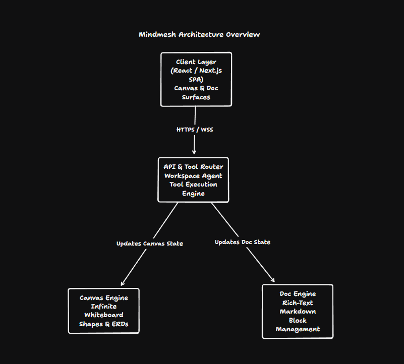
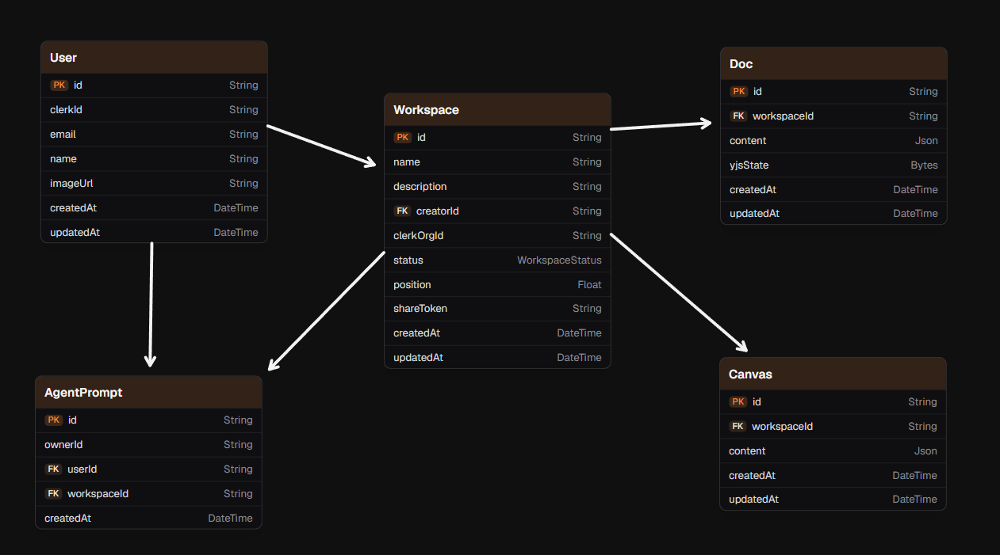

<div align="center">

# MindMesh

**A collaborative workspace where an AI agent turns ideas into synchronized diagrams and documents.**

</div>

## Overview

MindMesh brings planning work into one workspace with two connected surfaces: a rich-text document and an infinite canvas. Users can describe what they are planning, ask the workspace agent to create or update content, and collaborate with other workspace members while changes are synchronized in real time.

Workspaces can be organized on a kanban board, opened in document-only, canvas-only, or combined views, and shared through read-only links when the owner's plan permits it.

## Features

- **AI-assisted planning** — A Google Gemini-powered agent interprets requests and uses typed tools to read and update the active document and canvas.
- **Document editor** — BlockNote provides rich-text editing, Markdown-oriented agent operations, and PDF export support.
- **Infinite canvas** — tldraw provides the visual workspace, including a custom entity-table shape for database diagrams and relationship arrows that snap to table rows.
- **Real-time document collaboration** — Yjs synchronizes document updates, awareness, names, and cursors through Supabase Realtime.
- **Real-time canvas collaboration** — tldraw sync connects collaborators to per-workspace rooms backed by a Cloudflare Durable Object with SQLite storage.
- **Workspace management** — Create workspaces, track them by Planning, In Progress, In Review, and Done statuses, reorder cards, and view recent activity.
- **Authentication and organizations** — Clerk handles sign-in, user identity, optional organizations, roles, and access checks.
- **Read-only sharing** — Paid entitlements can enable revocable public links for viewing a workspace's document and canvas without signing in.
- **Usage and plan limits** — Agent prompts, workspaces, sharing, and PDF export are checked against free-plan limits and Clerk Billing features.
- **Responsive workspace views** — Resize the document and canvas panels or focus on either surface independently.

## Architecture

MindMesh is a Next.js App Router application. Server-rendered pages and Server Actions handle authenticated workspace access, persistence, sharing, usage tracking, and billing lookups. The `/api/agent` route streams Gemini responses through the Vercel AI SDK. Agent tools execute in the browser so they can operate on the live BlockNote and tldraw editor instances.

Documents have two persistence paths: a readable JSON copy for server-side features and a Yjs binary state that is merged transactionally in PostgreSQL. Active document sessions exchange Yjs updates and awareness messages through Supabase Realtime. Canvas snapshots are autosaved to PostgreSQL, while live canvas edits are synchronized through the optional `tldraw-sync` Cloudflare Worker.

Authentication is enforced by Clerk middleware for dashboard and workspace routes. Organization membership and roles are the access-control source of truth for organization workspaces; personal workspaces use the signed-in user's Clerk identity.

<div align="center">
  
</div>

## Database / Models

MindMesh uses PostgreSQL through Prisma. Each workspace is created with one associated document and one associated canvas. Clerk remains the source of truth for authentication and organization membership; the local `User` row stores the application-side identity and ownership relationship.

| Model | Purpose |
| --- | --- |
| `User` | Local profile linked to a unique Clerk user ID. Owns created workspaces and submitted agent prompts. |
| `Workspace` | Planning container with a kanban status, ordering position, optional Clerk organization, creator, and revocable share token. |
| `Doc` | One-to-one workspace document containing readable BlockNote JSON and the persisted Yjs state. |
| `Canvas` | One-to-one workspace canvas containing a tldraw snapshot. |
| `AgentPrompt` | Usage record for prompts, associated with the user and optionally retained after a workspace is deleted. |
| `WorkspaceStatus` | PostgreSQL enum with `PLANNING`, `IN_PROGRESS`, `IN_REVIEW`, and `DONE`. |

Relationships:

- A `User` can create many `Workspace` records.
- A `Workspace` has at most one `Doc` and one `Canvas`; both are cascade-deleted with the workspace.
- A `User` can submit many `AgentPrompt` records.
- A `Workspace` can have many prompt records; deleting the workspace sets their `workspaceId` to `NULL` so usage history cannot be reset.

<div align="center">
  
</div>

## Tech Stack

| Area | Technology | Purpose |
| --- | --- | --- |
| Application | [Next.js](https://nextjs.org/) 16 App Router | Pages, layouts, Server Actions, and API routes |
| UI | [React](https://react.dev/), [Tailwind CSS](https://tailwindcss.com/), Radix UI, Lucide | Interface and reusable components |
| Authentication | [Clerk](https://clerk.com/) | Sign-in, users, organizations, roles, and billing entitlements |
| Database | [PostgreSQL](https://www.postgresql.org/) via [Supabase](https://supabase.com/) | Persistent workspace, document, canvas, and usage data |
| ORM | [Prisma](https://www.prisma.io/) | Schema, migrations, and typed database access |
| AI | [Vercel AI SDK](https://ai-sdk.dev/) and [Google Gemini](https://ai.google.dev/) | Streaming agent responses and tool calls |
| Document editing | [BlockNote](https://www.blocknotejs.org/) | Rich-text document editor and PDF export |
| Document collaboration | [Yjs](https://yjs.dev/) and Supabase Realtime | Shared document state and awareness |
| Canvas | [tldraw](https://tldraw.dev/) | Infinite canvas, shapes, bindings, and snapshots |
| Canvas synchronization | Cloudflare Workers, Durable Objects, and SQLite | Per-workspace tldraw WebSocket rooms |

## Getting Started

### Prerequisites

- Node.js compatible with the project's Next.js 16 setup
- npm
- A PostgreSQL database
- Clerk application credentials
- Supabase project credentials
- Google AI Studio API key
- A deployed tldraw sync Worker for private, persistent canvas collaboration (optional for local experimentation)

### Clone the repository

```bash
git clone <repository-url>
cd mindmesh
```

### Install dependencies

Install the main application dependencies and generate the Prisma client:

```bash
npm install
npx prisma generate
```

The canvas synchronization Worker has its own package:

```bash
cd tldraw-sync
npm install
cd ..
```

### Configure environment variables

Create a local `.env` or `.env.local` file. Do not commit it or share its values.

| Variable | Required | Purpose |
| --- | --- | --- |
| `NEXT_PUBLIC_CLERK_PUBLISHABLE_KEY` | Yes | Clerk browser-side publishable key |
| `CLERK_SECRET_KEY` | Yes | Clerk server-side authentication and billing access |
| `DATABASE_URL` | Yes | PostgreSQL connection used by the application |
| `DIRECT_URL` | Recommended | Direct PostgreSQL connection used by Prisma CLI; `DATABASE_URL` is used when it is absent |
| `NEXT_PUBLIC_SUPABASE_URL` | Yes | Supabase project URL |
| `NEXT_PUBLIC_SUPABASE_PUBLISHABLE_KEY` | Yes | Supabase publishable key for Realtime |
| `GOOGLE_GENERATIVE_AI_API_KEY` | Yes | Google Gemini access for the workspace agent |
| `NEXT_PUBLIC_TLDRAW_SYNC_URL` | Optional | Base URL of the deployed tldraw sync Worker; when absent, the app uses tldraw's demo sync |
| `NEXT_PUBLIC_TLDRAW_LICENSE_KEY` | Optional | tldraw license key, especially for production use |
| `NEXT_PUBLIC_SITE_URL` | Optional | Public site URL used for generated metadata; defaults to `http://localhost:3000` |

The source code does not provide an `.env.example`, so use the variable names above and obtain values from the corresponding Clerk, Supabase, Google AI Studio, PostgreSQL, and Cloudflare deployments. Never place real keys in documentation.

### Set up the database

Apply the committed Prisma migrations:

```bash
npx prisma migrate deploy
```

For local schema development, use Prisma's normal migration workflow and regenerate the client after schema changes:

```bash
npx prisma migrate dev
npx prisma generate
```

### Configure canvas synchronization

To run the application with the repository's private canvas sync service:

```bash
cd tldraw-sync
npx wrangler login
npm run deploy
```

Set `NEXT_PUBLIC_TLDRAW_SYNC_URL` to the Worker URL in the main application's environment. The Worker uses one Durable Object room per canvas and stores room state in Durable Object SQLite storage. If the variable is omitted, the frontend falls back to tldraw's demo synchronization service.

### Run the development server

From the repository root:

```bash
npm run dev
```

Open [http://localhost:3000](http://localhost:3000), create an account, and create a workspace. The protected dashboard and workspace routes require Clerk authentication.

## Project Structure

```text
app/
  (auth)/                         Clerk sign-in and sign-up pages
  (main)/dashboard/               Dashboard, prompt entry, and recent workspaces
  (main)/workspaces/              Kanban workspace board
  (main)/workspace/[id]/          Combined document/canvas workspace
  api/agent/                      Streaming Gemini agent API route
  shared/[token]/                 Public read-only workspace view
  _components/                    Landing-page visual components
actions/                          Server Actions for users, workspaces, docs, canvas, and usage
components/
  EntityTable/                    Custom tldraw entity-table shape and relationship helpers
  ui/                             Reusable UI primitives
  DocEditor.tsx                   Collaborative BlockNote editor
  DocViewer.tsx                   Read-only document renderer
hooks/                            Collaborative document and agent-chat hooks
lib/
  agent-tools.ts                  Agent tool definitions and schemas
  agent-doc.ts                    Browser-side document tool execution
  agent-canvas.ts                 Browser-side canvas tool execution
  supabase-yjs-provider.ts        Yjs and Supabase Realtime provider
  billing.ts                      Clerk plan entitlement and usage logic
  workspace-access.ts             Workspace authorization checks
prisma/
  schema.prisma                   PostgreSQL data model
  migrations/                     Committed Prisma migrations
tldraw-sync/
  src/                            Cloudflare Worker and Durable Object room
  wrangler.toml                   Worker and Durable Object configuration
public/
  diagrams/                       Architecture and database model diagrams
  brand/                          Application branding assets
```

## Development

### Main application scripts

| Command | Description |
| --- | --- |
| `npm run dev` | Start the Next.js development server |
| `npm run build` | Create a production Next.js build |
| `npm run start` | Serve the production build |
| `npm run lint` | Run ESLint |

### Canvas sync scripts

Run these from `tldraw-sync/`:

| Command | Description |
| --- | --- |
| `npm run dev` | Start the Cloudflare Worker locally with Wrangler |
| `npm run deploy` | Deploy the canvas sync Worker |

After changing `prisma/schema.prisma`, create a migration, apply it to the target database, and run `npx prisma generate`.

## Contributing

1. Create a focused branch for your change.
2. Keep changes scoped to the feature or fix.
3. Update the Prisma schema and migrations together when changing persistent data.
4. Run `npm run lint` and the relevant build or local verification before opening a pull request.
5. Describe configuration, migration, and deployment implications in the pull request.

## License

This repository does not currently include a `LICENSE` file or declare a license in `package.json`. Until a license is added by the project owner, the code should be treated as unlicensed and should not be redistributed under an assumed open-source license.
